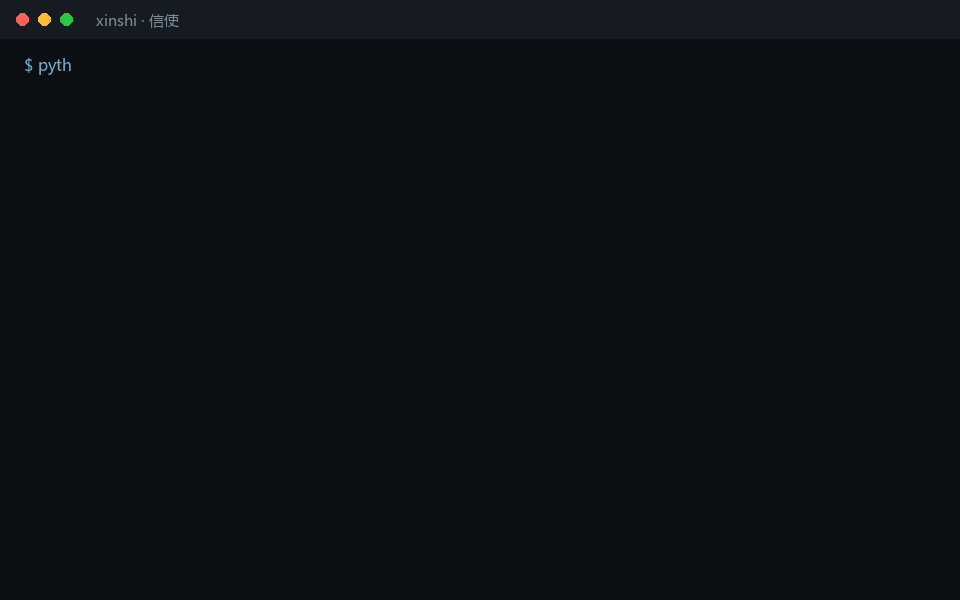
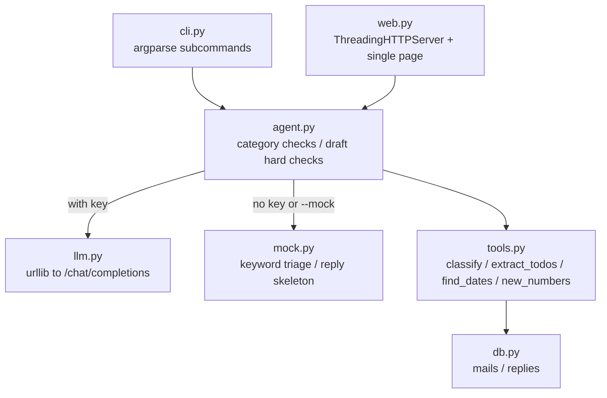

# Xinshi 信使

[](https://github.com/wushiyi105-jpg/xinshi/actions)
[]()
[](./LICENSE)
[](https://codecov.io/gh/wushiyi105-jpg/xinshi)



Paste an email in, get its category (important / to-do / notice / spam), a one-line summary, the actions it actually asks for, and a reply draft you can edit.

It **does not connect to a mailbox**. It never reads your inbox and never sends anything — the text you paste is its whole world. That limit is deliberate: once a real mailbox is attached, auth, incremental sync and attachment parsing become the main battleground, while "should I deal with this now" is the part that actually wears people out.

## Features

- **Four categories**: important / to-do / notice / spam. "To-do" outranks "important" on purpose — an email that wants both your signature and your reply needs the reply, and tagging it "important" only lets it sit in the inbox.
- **Priority 0–3**: spam starts at 0; urgent words, an explicit date and an important signal each add 1, capped at 3.
- **Every action traces back to the source**: each extracted to-do must appear in the original as a quote of at least 6 characters; anything not found is dropped with a note — that keeps the model from inventing tasks for you.
- **Deadlines only from the text**: dates such as `11 月 28 日`, `本周六` or `明天` are pulled by `tools.find_dates`; if the model reports a date that is not in the original, it is cleared and flagged.
- **No invented numbers in summaries**: a number in the summary that is absent from the source is reported as a problem; a new number in a reply draft sends the whole draft back to the skeleton — no amounts, dates or names made up.
- **Three reply tones**: `formal` / `friendly` / `brief`, capped at 200 / 200 / 60 characters; anything unconfirmed is written as `[待确认]`, and it never promises on your behalf.
- **Offline mode**: keyword rules handle categorisation and actions; replies degrade to a skeleton (received / points / next step / to fill), stating plainly that nothing was committed for you.
- **Two entry points**: CLI and web.

## Quick start

```bash
git clone https://github.com/wushiyi105-jpg/xinshi.git
cd xinshi
python -m xinshi add mail.txt --subject 报销单据补充材料 --sender 财务部
python -m xinshi triage 1
python -m xinshi reply 1 --tone brief
```

With a model:

```bash
cp .env.example .env
# set LLM_API_KEY; defaults are https://api.deepseek.com + deepseek-flash
```

```bash
LLM_BASE_URL=https://open.bigmodel.cn/api/paas/v4 LLM_MODEL=glm-4.6 python -m xinshi triage 1
```

Web UI:

```bash
python -m xinshi web --port 8770
# http://127.0.0.1:8770
```

`data/mails-sample.json` ships four sample emails covering all four categories — add them and try.

## Command reference

| Command | What it does |
| --- | --- |
| `add <file\|-> --subject <s> --sender <p>` | Paste an email; `-` reads stdin |
| `list [--limit N]` | List by priority |
| `show <id\|keyword>` | Body, category, actions, reply count |
| `triage <id\|keyword>` | Category + summary + actions + deadline, persisted |
| `reply <id> [--tone formal\|friendly\|brief]` | Generate and store a reply draft |
| `replies [--mail id]` | Draft list |
| `rm <id>` / `stats` / `web` | Delete (with drafts) / stats / web |

Global flags: `--mock`, `--json`, `--model`, `--base-url`, `--api-key`, `--db`.

## How it works



Three trade-offs:

1. **Actions must be traceable.** Models love to expand "submit one invoice" into "reconcile all of last month's receipts across lodging, meals and transport" — it sounds more professional, but you never said it. `verify_triage` only passes sentences that `contains_quote` can find in the source; invented ones are dropped.
2. **Numbers matter more than tone.** You will fix a clumsy tone yourself; a confidently invented "I'll pay the 1200 yuan by Friday" is an incident. `reply` diffs `tools.new_numbers` against the original email and sends the draft back to the skeleton over a single extra number.
3. **Category order is a product decision, not an algorithm one.** `classify` checks for strong spam signals first, then to-do, then important — because there are only three things people do with email: bin it, act now, or know about it. Putting "act now" ahead of "know about it" is what actually shortens the inbox.

One SQLite file with `check_same_thread=False` + `threading.Lock`, default `data/xinshi.db`, overridable via `XINSHI_DB`. Deleting an email deletes its `replies` first, without relying on foreign-key cascades.

## Layout

```
xinshi/
├── xinshi/
│   ├── __init__.py / __main__.py
│   ├── llm.py     # OpenAI-compatible client + .env loader
│   ├── db.py      # mails / replies
│   ├── tools.py   # classify, priority, actions, dates, number checks
│   ├── mock.py    # offline triage and reply skeleton
│   ├── agent.py   # triage checks, draft hard checks
│   ├── cli.py     # command line
│   └── web.py     # web UI
├── data/mails-sample.json
├── tests/test_xinshi.py
├── assets/demo.gif
├── .github/workflows/test.yml
├── pyproject.toml
├── README.md / README.en.md
└── CHANGELOG.md / SECURITY.md / CODE_OF_CONDUCT.md / CONTRIBUTING.md
```

## Author

shiyi · GitHub [@wushiyi105-jpg](https://github.com/wushiyi105-jpg) · wushiyi105@gmail.com

MIT License, Copyright (c) 2026 wushiyi105-jpg
