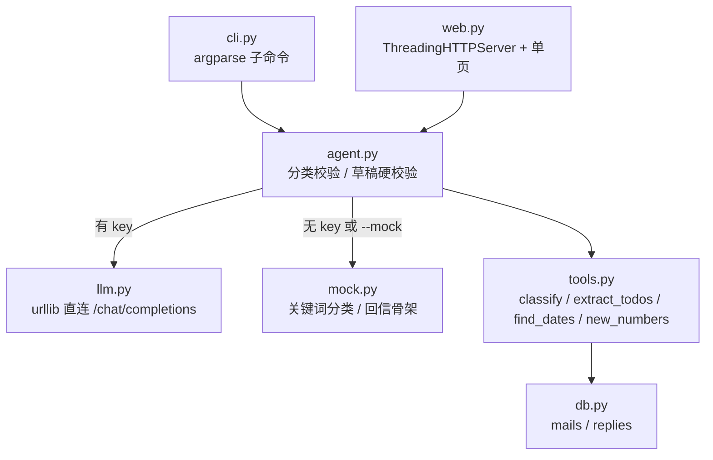

# 信使 xinshi

[](https://github.com/wushiyi105-jpg/xinshi/actions)
[]()
[](./LICENSE)
[](https://codecov.io/gh/wushiyi105-jpg/xinshi)


[打开这次本地实跑的结果图](assets/result.png) — 上面 GIF 与这张图都来自 2026-11-28 的新版界面，不是示意图。

把一封邮件粘进来,分出它是重要、待办、通知还是垃圾,摘出一句话,把该做的事单独列出来,再给一份能直接改的回信草稿。

它**不接邮箱**。不读你的收件箱,也不替你发信——粘进来的文本就是它的全部世界。这个限制是故意的:一旦接上真实邮箱,鉴权、增量同步、附件解析都会变成主战场,而"这封信到底要不要现在处理"才是真正耗人的地方。

## 功能特性

- **四类判定**:重要 / 待办 / 通知 / 垃圾。规则上「待办」优先于「重要」——既要你签字又要你回复的邮件,该做的是回复,标成"重要"只会让它在收件箱里躺着。
- **优先级 0–3**:垃圾 0 起;出现紧急词、明确日期、重要信号各加 1,封顶 3。
- **待办逐条对回原文**:模型给的每条待办都要能在原文里查到 ≥6 字原句,查不到的直接丢并告你一声——防它替你编任务。
- **截止时间只认原文**:`11 月 28 日`、`本周六`、`明天` 这类日期由 `tools.find_dates` 抽;模型报了个原文没有的日子,清空并提示。
- **摘要不许造数字**:摘要里出现原文没有的数字,记一条问题;回信草稿里出现新数字,整篇退回骨架——金额、日期、人名一个都不许凭空生。
- **回信三语气**:`formal` / `friendly` / `brief`,长度上限分别 200 / 200 / 60 字;没确认的条件一律写 `[待确认]`,不替你答应任何事。
- **离线模式**:分类与待办走关键词规则,回信只给骨架(收到 / 要点 / 下一步 / 待填),明说"没有替你表态"。
- **双入口**:CLI 与网页。

## 快速开始

```bash
git clone https://github.com/wushiyi105-jpg/xinshi.git
cd xinshi
python -m xinshi add mail.txt --subject 报销单据补充材料 --sender 财务部
python -m xinshi triage 1
python -m xinshi reply 1 --tone brief
```

接模型:

```bash
cp .env.example .env
# 填 LLM_API_KEY,默认 https://api.deepseek.com + deepseek-flash
```

```bash
LLM_BASE_URL=https://open.bigmodel.cn/api/paas/v4 LLM_MODEL=glm-4.6 python -m xinshi triage 1
```

网页:

```bash
python -m xinshi web --port 8770
# http://127.0.0.1:8770
```

`data/mails-sample.json` 里有四封示例邮件,覆盖四个分类,可直接 `add` 进去试。

Docker 运行(容器内用默认端口 8000):

```bash
docker build -t xinshi .
docker run -p 8000:8000 xinshi
```

## 命令参考

| 命令 | 作用 |
| --- | --- |
| `add <file\|-> --subject <题> --sender <人>` | 粘贴一封邮件,`-` 读 stdin |
| `list [--limit N]` | 按优先级列出 |
| `show <id\|关键词>` | 看一封:正文、分类、待办、回信数 |
| `triage <id\|关键词>` | 分类 + 摘要 + 待办 + 截止时间,落库 |
| `reply <id> [--tone formal\|friendly\|brief]` | 生成回信草稿并存档 |
| `replies [--mail id]` | 草稿列表 |
| `rm <id>` / `stats` / `web` | 删除(连带草稿) / 统计 / Web |

全局开关 `--mock`、`--json`、`--model`、`--base-url`、`--api-key`、`--db`。

## 🤔 为什么不用通用大模型直接问

通用模型读完一封邮件能告诉你「这封挺重要」,但信使补的是它做不到的三件事:

1. **待办要回查原文** —— 抽出来的每条待办、每个截止时间,都要在原文里找得到对应句子,找不到就丢;「11 月 28 日前」这种写法也能对上,不会把日期改写成模型记忆里的某一天。
2. **回信不许加数字** —— 草稿里出现原文没有的数字(金额、期限、订单号),整段退回重写,只给骨架;通用模型最爱在客气话里顺手承诺一个「3 个工作日内」。
3. **邮件留在本地** —— 不接真实邮箱,你把文本粘进来,分类、摘要、草稿都存在本机 SQLite,不会替你登录、也不会替你发。
4. **结构化输出** —— 分类(重要/待办/通知/垃圾)、优先级、摘要、待办、草稿都是固定字段,能汇总成清单;通用对话给一段判断,没法按优先级排队。

## 🎯 适用场景

- **早上先排队**:把收件箱里几封关键邮件粘进来,先看哪封是待办、哪封只是通知,处理顺序不用凭印象。
- **从会议邀请里抽待办**:一封长邮件里混着时间、地点、要准备的材料,抽出来逐条核对原文,不怕漏。
- **回客户先起草**:选语气(正式/简洁/友好)出一版草稿,核对没有多承诺,再自己发出去。

## 🗺 Roadmap

- **多封批量**:一次粘三封,输出一张分诊表,而不是一封一封来。
- **回复链**:记录这封回过没有、回的哪一版,避免重复回。
- **待办导出**:把抽出的待办导成 CSV 或 `.ics`,进任务工具或日历。
- **模板库**:退款、延期、催稿几类高频回复的骨架,按语气套。
- **多语言邮件**:中英混排的邮件也能正确分类与抽待办。

## ❓ FAQ

**API key 从哪来?**
项目不带 key。默认接 DeepSeek(`https://api.deepseek.com`),注册后填 `LLM_API_KEY`;任何 OpenAI 兼容端点都能换。

**数据存在哪,会连我的邮箱吗?**
不连。邮件文本是你粘贴进来的,存在本地 SQLite;它没有收件箱权限,也不会替你发送。

**没有 key 能不能用?**
能分类:关键词规则给出重要/待办/通知/垃圾,摘要用首句截断;回信草稿只有骨架,没有模型润色。

**怎么换模型?**
改 `LLM_BASE_URL`、`LLM_MODEL`、`LLM_API_KEY`,或用 `--model` 覆盖。

**会不会误判把重要邮件归到垃圾?**
可能,所以每条分类都附命中的关键词;你看到理由就能改。垃圾类要求至少命中两个信号才判,减少误杀。

## 工作原理



三处取舍:

1. **待办必须可回查**。模型很擅长把"补一张发票"扩写成"整理上月全部报销凭证并核对住宿、餐饮、交通三项",听着更专业,但你没说过。所以 `verify_triage` 只用 `contains_quote` 放行原文里找得到的句子,编出来的一律丢。
2. **回信的数字比回信的语气重要**。语气写歪了你自己会改,凭空写出"我周五前给您 1200 元"才是事故。`reply` 拿 `tools.new_numbers` 对比原邮件,多一个数字就退回骨架,并告诉你差在哪。
3. **分类顺序是产品判断,不是算法判断**。`classify` 先看垃圾信号是否够强,再看待办,最后看重要——因为人对邮件的动作只有三种:扔、马上做、放着知道。把"马上做"排在"知道"前面,收件箱才会变短。

SQLite 单文件,`check_same_thread=False` + `threading.Lock`,默认 `data/xinshi.db`,`XINSHI_DB` 可改。删邮件时先删 `replies` 再删 `mails`,不依赖外键级联。

## 目录结构

```
xinshi/
├── xinshi/
│   ├── __init__.py / __main__.py
│   ├── llm.py     # OpenAI 兼容客户端 + .env 加载
│   ├── db.py      # mails / replies
│   ├── tools.py   # 分类、优先级、待办抽取、日期、数字校验
│   ├── mock.py    # 离线分类与回信骨架
│   ├── agent.py   # 分类校验、草稿硬校验
│   ├── cli.py     # 命令行
│   └── web.py     # Web UI
├── data/mails-sample.json
├── tests/test_xinshi.py
├── assets/demo.gif
├── .github/workflows/test.yml
├── pyproject.toml
├── README.md / README.en.md
└── CHANGELOG.md / SECURITY.md / CODE_OF_CONDUCT.md / CONTRIBUTING.md
```

## 作者

小米 · 17612850106

MIT License,Copyright (c) 2026 wushiyi105-jpg
